# Laboratorio 14: Config Server y Resiliencia

**Curso:** Desarrollo de Aplicaciones Web (Tecsup)  
**Alumno:** Guillermo Willard, sección A  
**Repositorio:** https://github.com/willardguillermo/lab14-web

## 1. Objetivo

Agregar a la arquitectura de microservicios del Lab 13 (Cliente, Producto, Categoría y Pedido) un
**Config Server** para centralizar la configuración y los patrones de resiliencia **Circuit Breaker**,
**Retry** y **Bulkhead** con Resilience4j. Después se probó cómo responde la aplicación cuando un
servicio se cae o se pone lento.

**Sobre las evidencias:** las imágenes tituladas *Salida registrada* se generaron a partir de la
salida guardada de cada prueba, a veces filtrada o resumida. La de Eureka y las que dicen
*captura de Chrome* son capturas reales del navegador.

## 2. Config Server

Se creó el proyecto `config-server` (Spring Boot 3.5.15, Java 17, dependencia *Config Server*) con
`@EnableConfigServer` en el puerto 8888. Las configuraciones están en la carpeta `config-repo/` del
repositorio, y el servidor la encuentra con `search-paths`:

```yaml
server:
  port: 8888
spring:
  cloud:
    config:
      server:
        git:
          uri: https://github.com/willardguillermo/lab14-web
          search-paths: config-repo
          default-label: main
```

A los cuatro microservicios se les agregó `spring-cloud-starter-config`. Su `application.yaml` quedó así:

```yaml
spring:
  application:
    name: producto-service
  profiles:
    active: dev
  config:
    import: optional:configserver:http://localhost:8888
```

Primera versión, con el puerto y la base de datos en un solo archivo por servicio (leída de la copia local del repositorio):


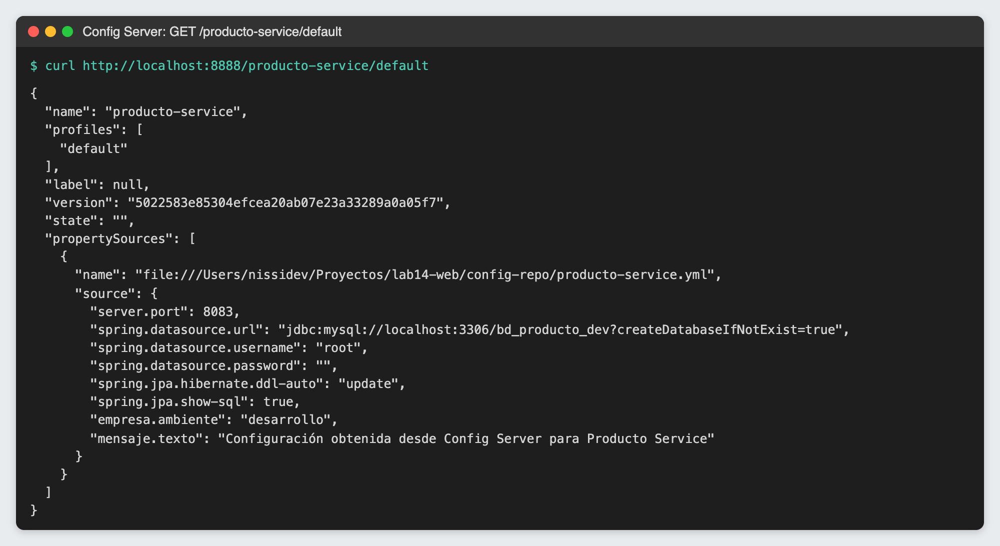

### Perfiles dev y prod

En `config-repo` cada servicio tiene tres archivos: `servicio.yml` (común: nombre, JPA y mensaje),
`servicio-dev.yml` (puerto 808x y BD local) y `servicio-prod.yml` (puerto 909x y BD del servidor).
Se eliminaron los `application-dev.yaml` locales de cada microservicio.

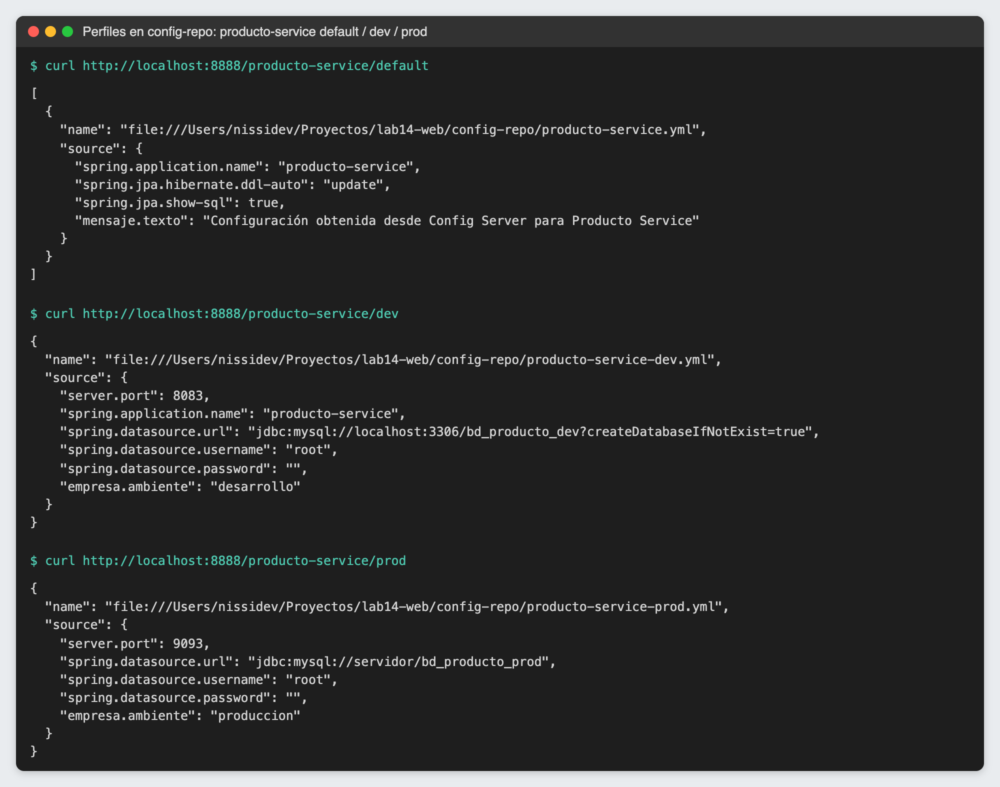

Las mismas consultas en el navegador (captura de Chrome), leyendo desde GitHub. Perfiles `default`, `dev` y `prod` de producto-service:

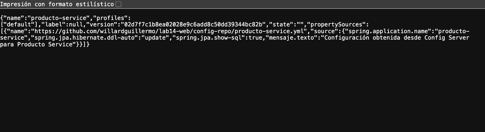

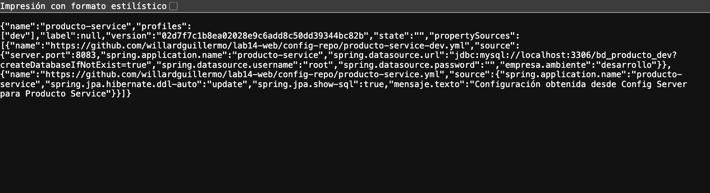

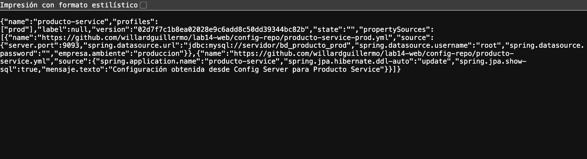

**Actividad (cliente y pedido):** se crearon los mismos archivos para `cliente-service` y `pedido-service`.

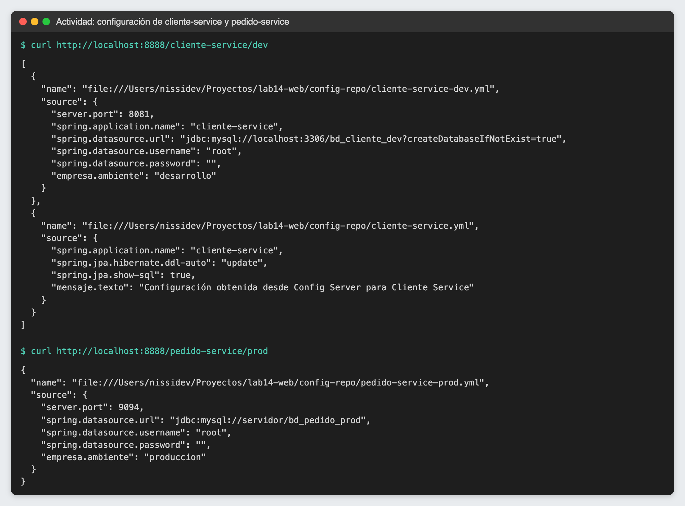

Cliente y pedido con perfil `dev` (captura de Chrome):

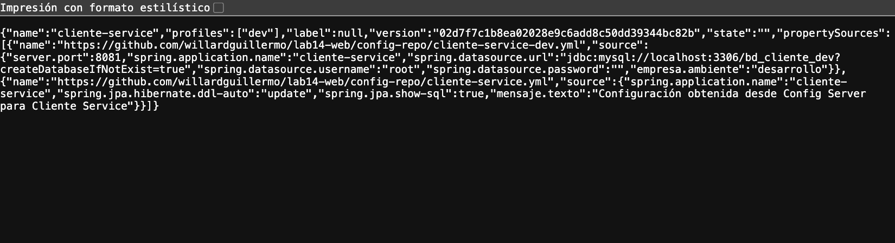

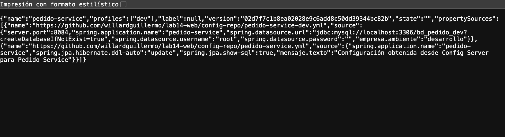

El perfil `prod` se verificó consultando el Config Server. No se arrancaron los servicios con él,
porque su base de datos (`servidor`) no existe en este equipo.

Configuración leída desde GitHub. Los cuatro servicios arrancan con el perfil `dev` que les entrega
el Config Server (endpoint `GET /config` de cada servicio):

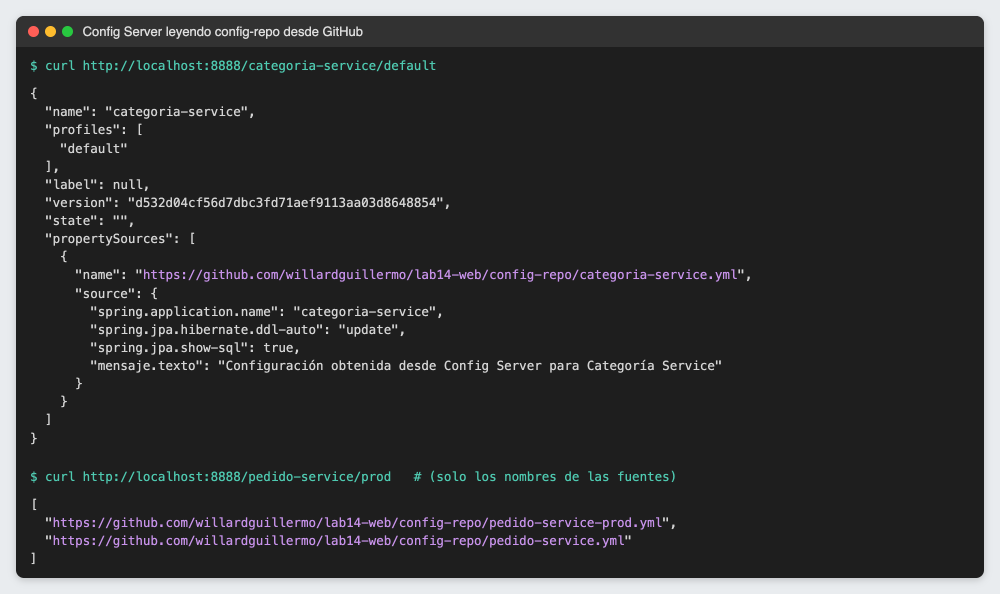

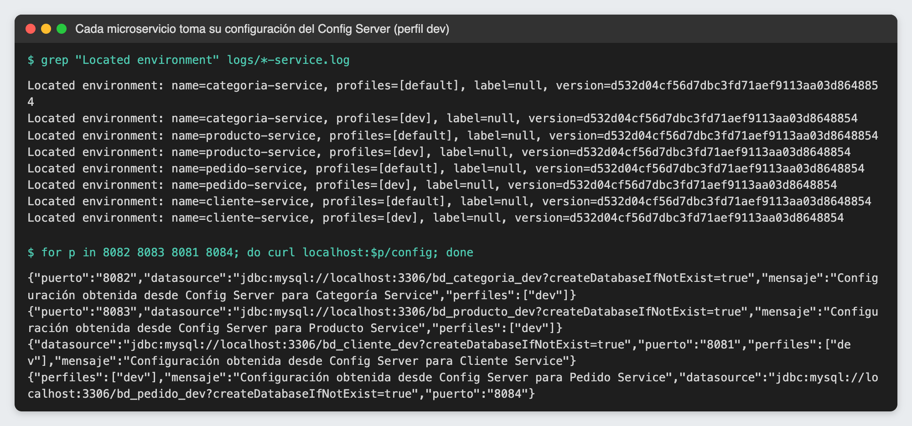

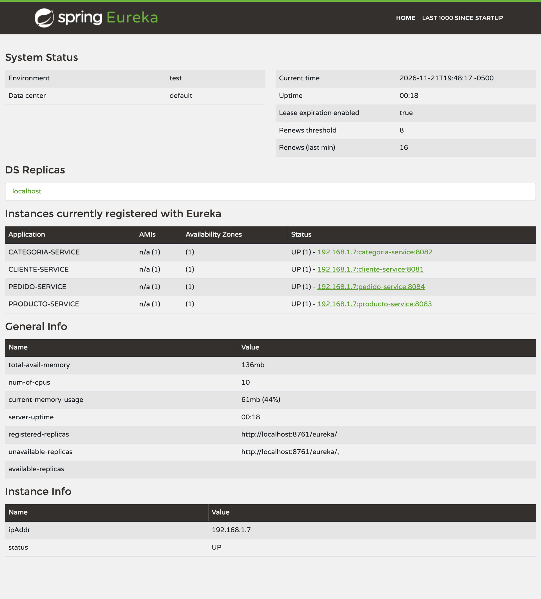

## 3. Circuit Breaker

En `producto-service` se agregaron `resilience4j-spring-boot3`, `spring-boot-starter-aop` y
`spring-boot-starter-actuator`. La clase `CategoriaCircuitService` envuelve la llamada Feign a
`categoria-service`. Si esa llamada falla, devuelve una categoría con el nombre
*"Categoría temporal no disponible"*.

```yaml
resilience4j:
  circuitbreaker:
    instances:
      categoriaService:
        registerHealthIndicator: true
        slidingWindowSize: 5
        minimumNumberOfCalls: 3
        failureRateThreshold: 50
        waitDurationInOpenState: 10s
```

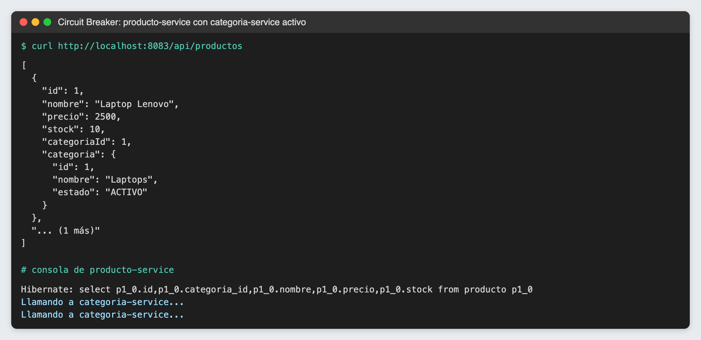

Al detener `categoria-service`, las primeras llamadas fallan con *Connection refused* y responden
con el fallback. Con el 50 % de fallos el circuito pasa a **OPEN**, y las llamadas siguientes ya ni
se intentan (*CircuitBreaker 'categoriaService' is OPEN and does not permit further calls*).

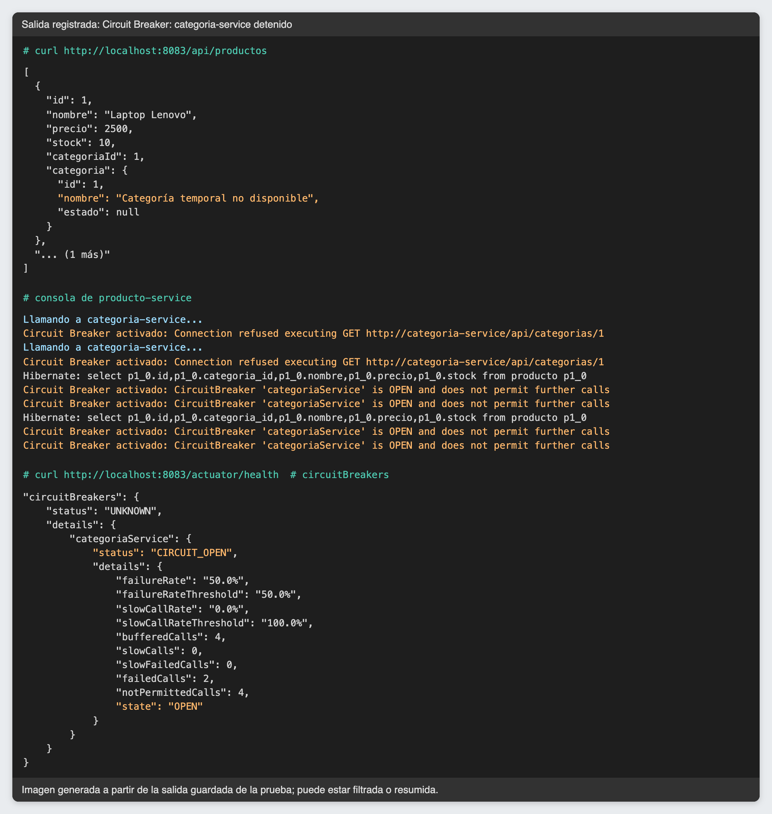

### Actividad: cliente-service → pedido-service

`cliente-service` consulta los pedidos de un cliente con Feign, en el endpoint nuevo
`GET /api/clientes/{id}/pedidos`. La llamada está protegida en `PedidoCircuitService`:

```java
@CircuitBreaker(name = "pedidoService", fallbackMethod = "pedidosFallback")
public PedidosClienteDTO obtenerPedidos(Long idCliente) {
    System.out.println("Llamando a pedido-service...");
    return new PedidosClienteDTO(idCliente, true, "OK", pedidoClient.listarPorCliente(idCliente));
}

public PedidosClienteDTO pedidosFallback(Long idCliente, Exception ex) {
    System.out.println("Circuit Breaker pedido activado: " + ex.getMessage());
    return new PedidosClienteDTO(idCliente, false, "Pedidos temporalmente no disponibles", List.of());
}
```

```yaml
resilience4j:
  circuitbreaker:
    instances:
      pedidoService:
        registerHealthIndicator: true
        slidingWindowSize: 5
        minimumNumberOfCalls: 3
        failureRateThreshold: 50
        waitDurationInOpenState: 10s
```

El campo `disponible` permite distinguir a un cliente sin pedidos de un `pedido-service` caído.
`pedido-service` responde en `/api/pedidos/cliente/{id}` sin volver a llamar a `cliente-service`,
para no crear un ciclo entre los dos.

Antes de la falla (la última imagen es captura de Chrome):

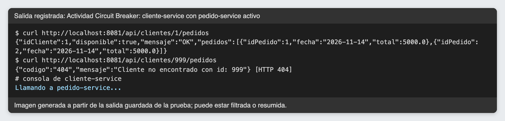

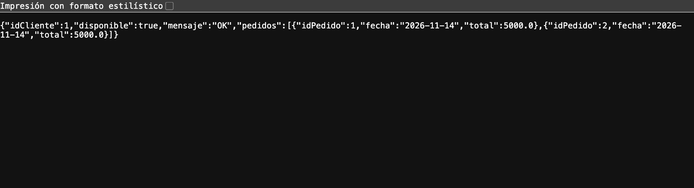

Con `pedido-service` detenido, dos llamadas fallan y el circuito se abre. Las siguientes reciben el fallback sin intentar la conexión:

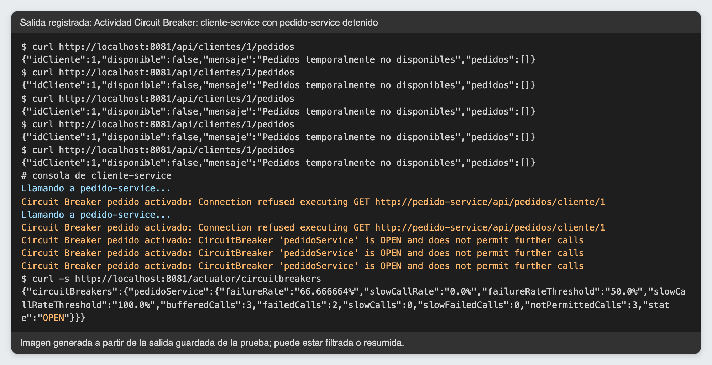

Al volver `pedido-service`, el circuito se cierra solo:

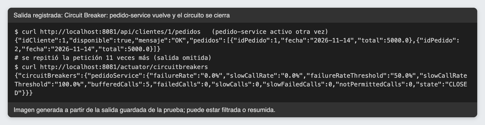

### Actividad: pedido-service → producto-service

Se creó `ProductoCircuitService` (circuito `productoService`). También se protegió la llamada a
`cliente-service` con `ClienteCircuitService`, que hace falta para la actividad de Retry. Ahora
`GET /api/pedidos` devuelve cada pedido con su cliente y el producto de cada detalle, y si un
servicio falla el pedido igual se muestra con el fallback. Estas dos evidencias se tomaron con la
versión final, que ya incluye el Retry de la sección 6.

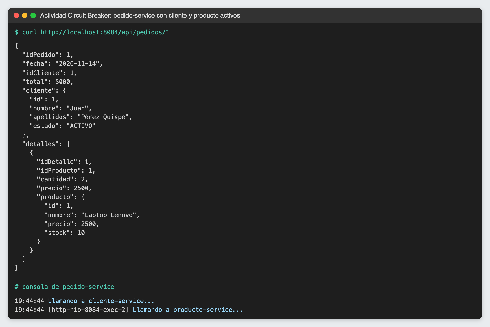

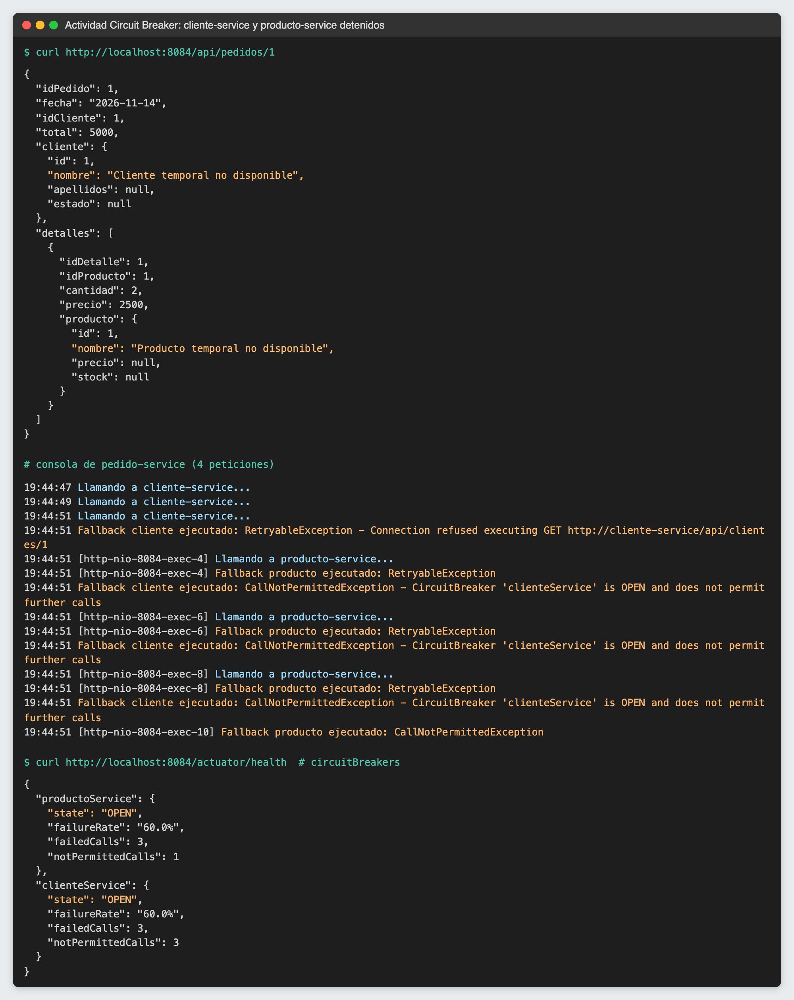

Listado completo con todos los servicios activos (captura de Chrome):

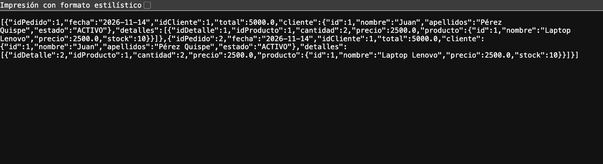

Los fallbacks se usan solo al consultar. Al registrar no se inventan datos: crear un producto con
`categoria-service` detenido respondió 503 y no guardó nada.

## 4. Retry Pattern

Se agregó `@Retry(name = "categoriaRetry")` con 3 intentos y 2 s de espera.

Con el código de la guía, que pone `fallbackMethod` tanto en `@Retry` como en `@CircuitBreaker`,
**la llamada no se reintentaba**. Resilience4j ejecuta los aspectos en el orden
`Retry( CircuitBreaker( Bulkhead( llamada ) ) )`. El fallback del Circuit Breaker atrapa la excepción
en el primer intento, así que el Retry recibe una respuesta "exitosa" y no vuelve a intentar.
En la consola solo aparece un *Llamando...* por categoría y la respuesta llega en 0.03 s:

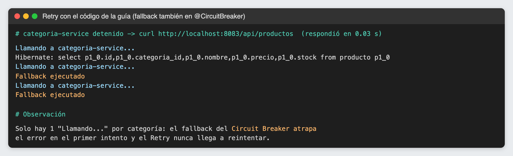

**Corrección:** el `fallbackMethod` se dejó solo en `@Retry` (el aspecto más externo). Además, el Retry
ya no reintenta cuando el circuito está abierto (`CallNotPermittedException`) ni ante un 404.
Ahora se ven los 3 intentos (≈4 s). Después de esos 3 fallos el circuito se abre y la petición
siguiente responde de inmediato con el fallback:

```java
@Retry(name = "categoriaRetry", fallbackMethod = "categoriaFallback")
@CircuitBreaker(name = "categoriaService")
@Bulkhead(name = "categoriaBulkhead")
public CategoriaDTO obtenerCategoria(Long id) {
    System.out.println("Llamando a categoria-service...");
    return categoriaClient.obtenerCategoria(id);
}
```

```yaml
  retry:
    instances:
      categoriaRetry:
        maxAttempts: 3
        waitDuration: 2s
        ignoreExceptions:
          - io.github.resilience4j.circuitbreaker.CallNotPermittedException
          - feign.FeignException$NotFound
```

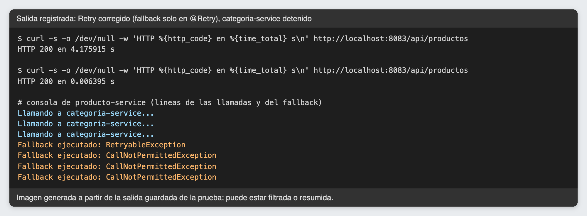

## 5. Bulkhead Pattern

Se agregó `@Bulkhead(name = "categoriaBulkhead")` con un máximo de 2 llamadas simultáneas y 1 s de
espera. En `categoria-service` la demora se simula con `Thread.sleep`. Para no cambiar el código en
cada prueba, el tiempo se pasa por parámetro (`--simulacion.demora-ms=10000`).

```yaml
  bulkhead:
    instances:
      categoriaBulkhead:
        maxConcurrentCalls: 2
        maxWaitDuration: 1s
```

Se lanzaron 5 peticiones simultáneas ("5 pestañas"). Las 2 primeras ocupan los cupos y tardan 20 s
(2 productos × 10 s). Las otras 3 esperan 1 s por cada producto, no consiguen cupo
(`BulkheadFullException`) y reciben el fallback en 2 s:

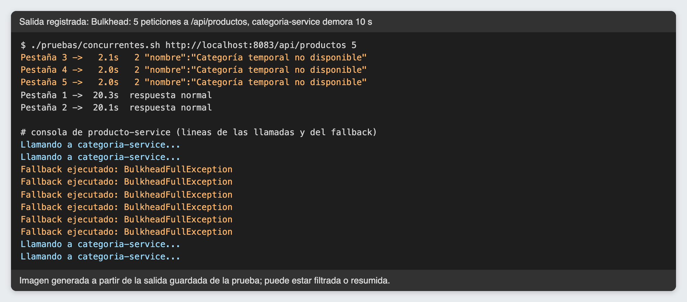

## 6. Actividad: Retry y Bulkhead en pedido-service

**Retry para la consulta al cliente** (`ClienteCircuitService`):

```java
@Retry(name = "clienteRetry", fallbackMethod = "clienteFallback")
@CircuitBreaker(name = "clienteService")
public ClienteDTO obtenerCliente(Long id) {
    System.out.println(LocalTime.now() + " Llamando a cliente-service...");
    return clienteClient.obtenerCliente(id);
}
```

**Bulkhead para la consulta al producto** (`ProductoCircuitService`):

```java
@CircuitBreaker(name = "productoService", fallbackMethod = "productoFallback")
@Bulkhead(name = "productoBulkhead")
public ProductoDTO obtenerProducto(Long id) {
    System.out.println(LocalTime.now() + " [" + hilo + "] Llamando a producto-service...");
    return productoClient.obtenerProducto(id);
}
```

**application.yml de pedido-service** (sin contar Eureka ni Actuator):

```yaml
spring:
  cloud:
    openfeign:
      client:
        config:
          cliente-service:
            connect-timeout: 2000
            read-timeout: 3000     # la demora de 5 s provoca timeout -> Retry
resilience4j:
  circuitbreaker:
    instances:
      clienteService:  { slidingWindowSize: 5, minimumNumberOfCalls: 3, failureRateThreshold: 50, waitDurationInOpenState: 10s }
      productoService: { slidingWindowSize: 5, minimumNumberOfCalls: 3, failureRateThreshold: 50, waitDurationInOpenState: 10s,
                         ignoreExceptions: [io.github.resilience4j.bulkhead.BulkheadFullException] }
  retry:
    instances:
      clienteRetry:
        maxAttempts: 3
        waitDuration: 2s
        ignoreExceptions:
          - io.github.resilience4j.circuitbreaker.CallNotPermittedException
          - feign.FeignException$NotFound
  bulkhead:
    instances:
      productoBulkhead:
        maxConcurrentCalls: 2
        maxWaitDuration: 1s
```

### Demora de 5 s en cliente-service (Retry)

Feign corta cada llamada a los 3 s (*Read timed out*). El Retry la repite 3 veces, con un intento
cada 5 s (3 s de timeout + 2 s de espera). Después ejecuta el fallback. Esos 3 fallos abren el
circuito `clienteService`, así que el segundo pedido recibe el fallback al instante.
`GET /api/pedidos` tardó 13.4 s.

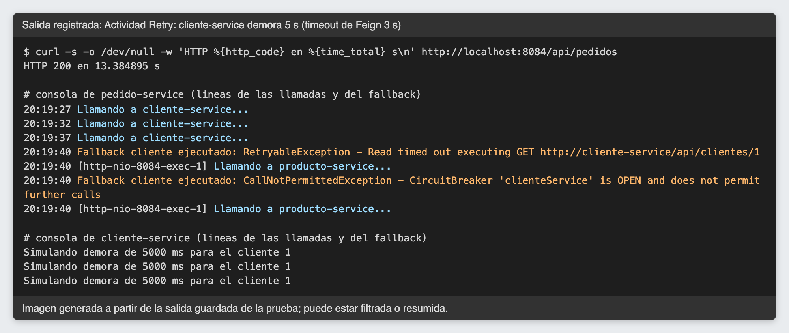

### Demora de 10 s en producto-service (Bulkhead)

De 5 peticiones simultáneas a `GET /api/pedidos`, solo 2 hilos llaman a `producto-service`
(*exec-1* y *exec-2*) y tardan 20 s. Los otros 3 reciben `BulkheadFullException` tras esperar 1 s por cada
producto y responden en 2 s con *"Producto temporal no disponible"*. Los hilos de `pedido-service` no se quedan
bloqueados esperando al servicio lento.

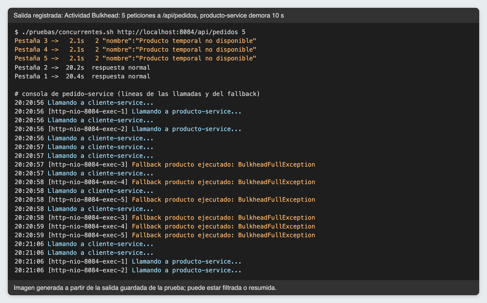

### Ambas demoras a la vez

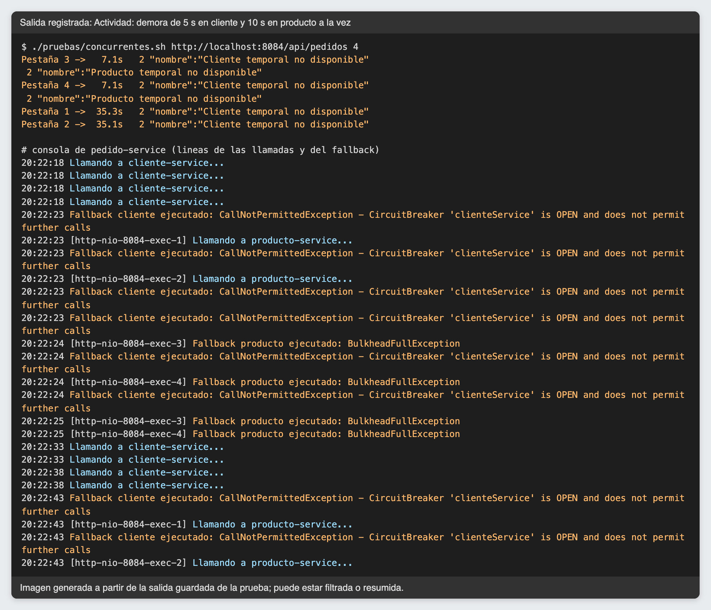

Las 4 peticiones llaman a `cliente-service` al mismo tiempo y fallan juntas por timeout. Esos fallos
abren el circuito `clienteService` durante el primer intento, así que cuando el Retry quiere
reintentar recibe `CallNotPermittedException` y pasa al fallback: no llega a los 3 intentos. Después
el Bulkhead deja pasar 2 peticiones a `producto-service` (35 s en total) y rechaza las otras 2 (7 s).
El Circuit Breaker corta los reintentos cuando ya hay evidencia de que el servicio está mal.

### Comportamiento observado y diferencias entre Retry y Bulkhead

| | Retry | Bulkhead |
|---|---|---|
| Qué hace | Repite una llamada que falló | Limita cuántas llamadas simultáneas se hacen a un servicio |
| Problema que resuelve | Fallos **temporales**: un timeout puntual, un reinicio, un microcorte de red | **Saturación**: un servicio lento que acapara hilos y conexiones |
| Efecto en el tiempo | La respuesta tarda más (3 intentos: 13.4 s en la prueba) | Las peticiones que no entran fallan rápido (2 s) |
| Riesgo | Si el servicio está caído, multiplica la carga y la espera; por eso se combina con Circuit Breaker | Rechaza peticiones aunque el servicio funcione, solo por estar ocupado |
| Cuándo usarlo | Operaciones idempotentes (consultas GET) contra servicios que suelen recuperarse solos | Dependencias lentas o con capacidad limitada, para proteger al resto de la aplicación |

En resumen, el **Retry** apuesta a que el error se arregla solo e insiste. El **Bulkhead** asume que
el servicio está lento y pone un límite para que ese problema no se lleve todos los recursos. Por
eso conviene Retry en la consulta del cliente, que es rápida y casi siempre falla por algo puntual,
y Bulkhead en la del producto, que se llama varias veces por pedido y puede saturar a `pedido-service`.

## 7. Conclusiones

1. El Config Server permite cambiar puertos, bases de datos o mensajes de todos los microservicios
   desde un solo repositorio, sin recompilarlos. Con los perfiles `dev` y `prod` el mismo código
   sirve en cada ambiente.
2. El Circuit Breaker evita que la caída de un servicio se propague. Cuando categoría, cliente,
   producto o pedido se detuvieron, los servicios que los consumen siguieron respondiendo con datos de
   fallback, y con el circuito abierto ni siquiera esperaron a que la conexión falle.
3. El orden de las anotaciones de Resilience4j importa: el `fallbackMethod` debe ir en el aspecto más
   externo (`@Retry`). Si no, los aspectos internos atrapan el error y el Retry nunca reintenta, como
   pasó con el código de la guía.
4. El Retry solo sirve para fallos temporales y debe tener un límite. Hay que excluir los errores que
   no se arreglan reintentando (404, circuito abierto), porque cada intento suma tiempo de respuesta.
5. El Bulkhead aísla los recursos. Con un servicio de 10 s de demora, solo 2 llamadas lo esperaron y
   el resto recibió respuesta en 2 s, así que la aplicación siguió atendiendo en lugar de quedarse sin hilos.
